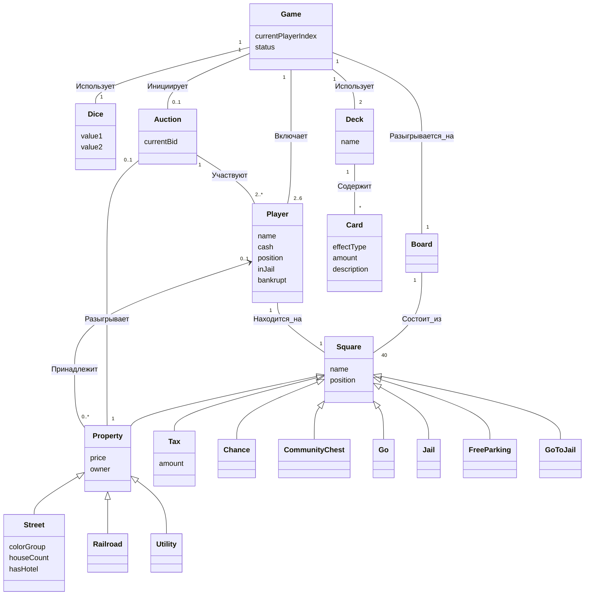

# Модель предметной области
Примерная модель предметной области, представляемая классами приложения. Банк, ипотека и дубли в модели не учитываются; владелец собственности хранится в самой клетке.

## Описание атрибутов

| Класс | Атрибут | Описание |
|---|---|---|
| Game | currentPlayerIndex | номер игрока, который сейчас ходит |
| Game | status | состояние партии (идёт / завершена) |
| Player | name | имя участника, отображаемое в игре |
| Player | cash | текущий баланс игрока |
| Player | position | номер клетки, на которой стоит игрок (0–39) |
| Player | inJail | признак нахождения игрока в тюрьме |
| Player | bankrupt | признак выбывания игрока из игры |
| Square | name | наименование клетки на поле |
| Square | position | порядковый номер клетки на доске (0–39) |
| Property | price | номинальная стоимость покупки |
| Property | owner | игрок, которому принадлежит клетка (пусто — клетка свободна) |
| Street | colorGroup | цвет набора улиц (монополии) |
| Street | houseCount | число построенных домов (0–4) |
| Street | hasHotel | признак наличия отеля на улице |
| Tax | amount | фиксированная сумма налога к оплате |
| Dice | value1 | результат броска первого кубика (1–6) |
| Dice | value2 | результат броска второго кубика (1–6) |
| Deck | name | тип колоды (Шанс / Общая казна) |
| Card | effectType | вид действия карточки (штраф, бонус, перемещение и т.п.) |
| Card | amount | денежная величина эффекта, если есть |
| Card | description | текст карточки, показываемый игроку |
| Auction | currentBid | наибольшая ставка на данный момент |

## Где хранится состояние

- **Владелец клетки** — в поле `owner` у Собственности. Связь «Принадлежит» направлена от клетки к игроку: игрок свои клетки не хранит, а при необходимости (проверка монополии, банкротство, аренда за ж/д) они находятся перебором клеток доски по полю `owner`.
- **Застройка** — в самой улице: `houseCount` (0–4) и `hasHotel`. При постройке отеля `houseCount` обнуляется.
- **Деньги** — только у игроков (`cash`); отдельного Банка нет.
