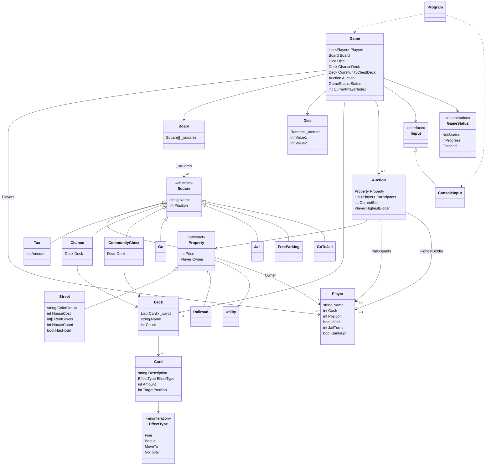

# Модель предметной области

Модель описывает данные и связи классов игры. Сигнатуры методов доступны в [диаграмме классов](<система.puml>), а порядок вызовов — в [описаниях прецедентов](<прецеденты>).

## Основные данные

| Класс | Данные и назначение |
|---|---|
| Game | Игроки, поле, кубики, две колоды, текущий аукцион, состояние игры и индекс текущего игрока. |
| GameStatus | Состояния партии: не начата, идёт и завершена. |
| Player | Имя, деньги, позиция, состояние тюрьмы, число пропущенных ходов и признак банкротства. |
| Board | Массив из 40 клеток. По нему находятся клетки, владения игроков и улицы одной цветовой группы. |
| Square | Название и позиция клетки. Вычисляемое свойство `DisplayName` задаёт отображаемое имя. |
| Property | Цена и необязательный владелец. |
| Street | Цветовая группа, стоимость дома, уровни аренды, количество домов и наличие отеля. |
| Tax | Сумма налога. |
| Chance, CommunityChest | Ссылка на соответствующую колоду. |
| Dice | Значения двух кубиков и генератор случайных чисел. |
| Deck | Название, список карточек и вычисляемое количество карточек. Клетки одного типа используют общую колоду. |
| Card | Описание, вид эффекта, сумма и целевая позиция. |
| EffectType | Штраф, бонус, перемещение и отправка в тюрьму. |
| Auction | Выставленная собственность, участники, текущая ставка и необязательный лидер. |
| Program, IInput, ConsoleInput | Точка входа, интерфейс ввода и его консольная реализация. |

## Где хранится состояние

- Владелец хранится в `Property.Owner`. `Board.GetPropertiesOf(player)` находит владения по этому свойству.
- Застройка хранится в `Street.HouseCount` и `Street.HasHotel`. При постройке отеля количество домов обнуляется.
- Деньги хранятся у игроков в `Player.Cash`. Отдельного банка в игре нет.
- Порядок карточек хранится в `Deck._cards`, а очерёдность игроков — в `Game.Players`. Банкроты сохраняются в списке, но пропускаются при смене хода.
- Владелец, аукцион и лидер аукциона могут отсутствовать. До начала партии список игроков может быть пустым.
