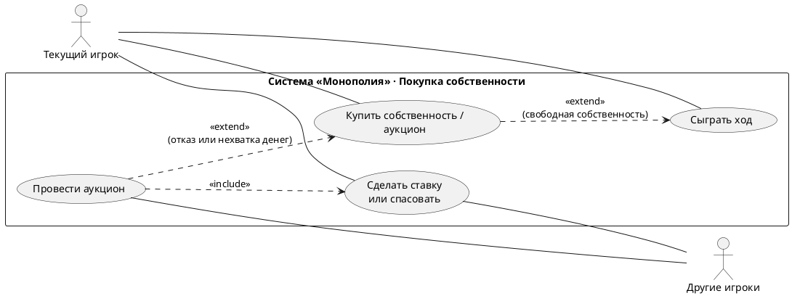

# Купить собственность / выставить на аукцион

**Область действия** — консольная игра «Монополия».

**Уровень** — пользовательская цель.

**Основные исполнители** — текущий игрок и участники аукциона.

## Заинтересованные лица и их требования

- **Текущий игрок** может приобрести свободную собственность по установленной цене, если ему хватает денег, или участвовать в торгах.
- **Другие игроки** могут участвовать в аукционе, если прямая покупка не состоялась.

### Предусловия

- Партия находится в состоянии `GameStatus.InProgress`.
- Текущий игрок попал на клетку `Property` с `Owner == null` после броска кубиков или по карточке перемещения.

### Результаты (постусловия)

- При прямой покупке с текущего игрока списана цена, он становится владельцем клетки.
- При продаже на аукционе с победителя списана его ставка, он становится владельцем клетки.
- Если ставок не было, клетка остаётся свободной.
- Управление возвращается в обработку хода.

## Основной успешный сценарий

1. `Property.OnLand(player, game)` обнаруживает, что клетка свободна, и вызывает `Game.OfferPurchase(player, property)`.
2. `Player.CanAfford(property.Price)` подтверждает, что текущий игрок может заплатить полную цену.
3. `Game.AskBuyDecision(player, property)` запрашивает согласие через `IInput.AskYesNo(question)`. Текущий игрок соглашается.
4. `Game` вызывает `Player.Pay(property.Price)` и `Property.SetOwner(player)`, затем сообщает о покупке.
5. Обработка клетки завершается, `Game.PlayTurn()` продолжает ход.

## Расширения (альтернативные потоки)

**2a. У текущего игрока недостаточно денег.** `Game` сразу выставляет клетку на аукцион. Вопрос о прямой покупке пропускается.

**3a. Текущий игрок отказывается.** `Game` выставляет клетку на аукцион.

### Проведение аукциона

1. `Game.StartAuction(property)` создаёт объект `Auction` со всеми игроками без банкротства, включая текущего игрока. Начальная ставка равна 0.
2. `Game` запрашивает ставки по кругу и пропускает текущего лидера. `Auction.PlaceBid(bidder, bid)` принимает ставку, если игрок участвует в торгах, ставка строго выше текущей и у игрока хватает средств. Допустимая ставка обновляет `CurrentBid` и `HighestBidder`.
3. Ввод 0 или любая отклонённая ставка приводит к `Auction.Pass(bidder)`. Игрок выбывает из этих торгов.
4. `Auction.IsFinished()` возвращает `true`, если участников не осталось или остался один участник и есть лидер.
5. Если есть лидер, `Auction.Conclude()` списывает выигрышную ставку и назначает его владельцем. Если ставок не было, клетка остаётся свободной.
6. `Game` сообщает результат, очищает `Game.Auction` и возвращает управление в обработку хода.

## Особые требования

- `Game` координирует покупку, запрашивает ставки и завершает аукцион.
- `Property` хранит цену и владельца. `Player` проверяет доступные средства и меняет свой баланс.
- `Auction` хранит временное состояние торгов и проверяет допустимость ставок. Деньги за выигрышную ставку списываются после торгов.

## Частота использования

При каждом попадании на свободную собственность.

## Взаимодействие с другими прецедентами

| Связь | Тип | Условие |
|---|---|---|
| Купить собственность / аукцион → Сыграть ход | «extend» | Игрок попал на свободную собственность |
| Провести аукцион → Купить собственность / аукцион | «extend» | Игрок отказался от прямой покупки или ему не хватило денег |
| Провести аукцион → Сделать ставку или спасовать | «include» | Игра запрашивает ставку у участника, который сейчас не лидирует |

## User Stories

### US3.1. Покупка по цене

Как **текущий игрок**, попавший на свободную собственность, я хочу купить её по установленной цене, чтобы получать аренду.

**Критерии приёмки**

- `Player.CanAfford(price)` вызывается перед запросом согласия.
- При согласии цена списывается через `Player.Pay(price)`. `Property.SetOwner(player)` назначает текущего игрока владельцем.
- Управление возвращается в обработку хода.

### US3.2. Отказ от покупки

Как **текущий игрок**, я хочу иметь возможность отказаться от покупки по установленной цене.

**Критерии приёмки**

- При отказе цена не списывается.
- `Game.StartAuction(property)` запускает торги.

### US3.3. Участие в аукционе

Как **участник торгов**, я хочу повышать ставку или выйти из торгов.

**Критерии приёмки**

- `Game` включает в торги всех игроков без банкротства и пропускает текущего лидера при запросе ставки.
- `Auction.PlaceBid(bidder, bid)` принимает ставку выше текущей, если участник может её оплатить.
- Ввод 0 или недопустимой ставки приводит к `Auction.Pass(bidder)`.

### US3.4. Итог аукциона

Как **победитель аукциона**, я хочу получить собственность за свою ставку.

**Критерии приёмки**

- `Auction.Conclude()` списывает сумму `CurrentBid` у `HighestBidder` и назначает его владельцем.
- При отсутствии ставок `Property.Owner` остаётся `null`.

### US3.5. Нехватка денег

Как **текущий игрок**, которому не хватает денег на прямую покупку, я хочу иметь возможность участвовать в аукционе.

**Критерии приёмки**

- Если `Player.CanAfford(price)` возвращает `false`, игра сразу вызывает `Game.StartAuction(property)`.
- Игрок может сделать ставку в пределах своего баланса или спасовать.

[Системные операции](<Описание операций.md>) · [Диаграмма последовательности](<Купить собственность_аукцион — диаграмма.puml>)
