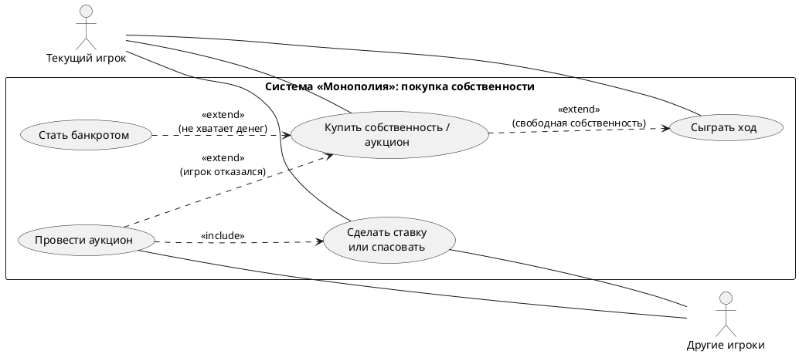

# Купить собственность / выставить на аукцион

**Область действия:** система «Монополия»

**Уровень:** пользовательская цель

**Основной исполнитель:** текущий Игрок

## Заинтересованные лица и их требования

- **Текущий игрок.** Хочет приобрести свободную собственность за установленную цену либо отказаться от покупки и завершить обработку клетки.
- **Другие игроки.** Заинтересованы в возможности участвовать в аукционе, если текущий игрок отказался от покупки свободной собственности.
- **Game.** Должен координировать обработку клетки, покупку собственности и запуск аукциона.
- **Property.** Должна хранить цену и владельца собственности и обрабатывать попадание игрока на клетку.
- **Auction.** Должен управлять временным процессом торгов и определить победителя.
- **Player.** Должен проверять наличие средств и выполнять оплату.

### Предусловия

- Игра начата.
- Определён текущий игрок, чья очередь ходить.
- Текущий игрок попал на клетку типа `Property`.
- Собственность свободна.

### Результаты (Постусловия)

- При успешной покупке стоимость собственности списана с игрока.
- Собственность закреплена за игроком (`Property.owner = player`).
- При отказе от покупки проведён аукцион.
- При наличии победителя сумма выигрышной ставки списана с победителя, а собственность передана ему.
- При отсутствии победителя собственность остаётся свободной.

## Основной успешный сценарий

1. Текущий игрок в рамках своего хода попадает на свободную клетку собственности.
2. `Game` получает клетку через `Board.getSquare(position)`.
3. `Game` вызывает `Property.onLand(player, game)`.
4. `Property` определяет, что собственность свободна.
5. Система предлагает игроку купить собственность.
6. Игрок соглашается на покупку.
7. Система проверяет наличие у игрока достаточного количества денег через `Player.canAfford(price)`.
8. Система списывает стоимость собственности через `Player.pay(price)`.
9. Собственность закрепляется за игроком: `Property.owner = player`.
10. Покупка завершается.
11. `Game` продолжает обработку хода.
12. Ход переходит к новому игроку.

## Расширения (альтернативные потоки)

**6a. Игрок отказывается от покупки.**

&nbsp;&nbsp;1. Игрок отказывается покупать свободную собственность.

&nbsp;&nbsp;2. `Property` инициирует аукцион через `Game.startAuction(property)`.

&nbsp;&nbsp;3. `Game` создаёт объект `Auction` с участниками торгов.

&nbsp;&nbsp;4. Участники делают ставки через `Auction.placeBid(amount)`.

&nbsp;&nbsp;5. Участник может отказаться от дальнейшего участия через `Auction.pass()`.

&nbsp;&nbsp;6. Торги продолжаются до завершения аукциона.

&nbsp;&nbsp;7. `Auction.conclude()` определяет результат торгов.

&nbsp;&nbsp;&nbsp;&nbsp;**7a. Есть победитель.**

&nbsp;&nbsp;&nbsp;&nbsp;&nbsp;&nbsp;1. Проверяется, хватает ли у победителя денег на текущую ставку через `Player.canAfford(currentBid)`.

&nbsp;&nbsp;&nbsp;&nbsp;&nbsp;&nbsp;2. С победителя списывается сумма выигрышной ставки через `Player.pay(currentBid)`.

&nbsp;&nbsp;&nbsp;&nbsp;&nbsp;&nbsp;3. `Property.owner` устанавливается в значение победителя.

&nbsp;&nbsp;&nbsp;&nbsp;**7b. Победителя нет.**

&nbsp;&nbsp;&nbsp;&nbsp;&nbsp;&nbsp;1. Аукцион завершается без передачи собственности.

&nbsp;&nbsp;&nbsp;&nbsp;&nbsp;&nbsp;2. Собственность остаётся без владельца.

**7c. У игрока недостаточно средств для прямой покупки.**

&nbsp;&nbsp;1. `Player.canAfford(price)` возвращает отрицательный результат.

&nbsp;&nbsp;2. Покупка не выполняется.

&nbsp;&nbsp;3. `Game` запускает предусмотренную моделью обработку банкротства через `handleBankruptcy(...)`.

&nbsp;&nbsp;4. Аукцион не запускается автоматически только из-за недостатка средств: в данной модели аукцион связан с отказом игрока от покупки.

## Особые требования

- `Game` является координатором сценария.
- `Property` обрабатывает попадание игрока на клетку через `onLand(player, game)`.
- `Player` отвечает за проверку своих средств и оплату.
- Владелец хранится только в самой клетке (`Property.owner`); у `Player` нет списка собственности.
- `Auction` является отдельным временным объектом для проведения торгов.
- Аукцион запускается при отказе игрока от покупки свободной собственности.
- Ипотека в рассматриваемой модели отсутствует.

## Частота использования

Прецедент выполняется каждый раз, когда игрок попадает на свободную клетку собственности.

## Взаимодействие с другими прецедентами

| Связь | Тип | Условие |
|---|---|---|
| Купить собственность / аукцион → Сыграть ход | «extend» | Игрок попал на свободную собственность (`Property.onLand`) |
| Провести аукцион → Купить собственность / аукцион | «extend» | Игрок отказался от покупки (расширение 6a, `Game.startAuction`) |
| Провести аукцион → Сделать ставку или спасовать | «include» | Каждый участник торгов обязательно ставит (`Auction.placeBid`) или пасует (`Auction.pass`) |
| Стать банкротом → Купить собственность / аукцион | «extend» | `Player.canAfford(price)` вернул отрицательный результат (расширение 7c, `handleBankruptcy`) |

## User Stories

### US3.1. Покупка по цене
Как **текущий игрок**, попавший на свободную собственность, я хочу купить её по установленной цене, чтобы она стала моей и приносила аренду.

**Критерии приёмки:**
- система предлагает покупку только для свободной клетки `Property`;
- перед покупкой проверяется `Player.canAfford(price)`;
- цена списывается через `Player.pay(price)`;
- `Property.owner` становится текущим игроком;
- после покупки управление возвращается в сценарий хода.

### US3.2. Отказ от покупки
Как **текущий игрок**, я хочу отказаться от покупки, чтобы не тратить деньги на невыгодную собственность.

**Критерии приёмки:**
- отказ не списывает деньги;
- отказ автоматически запускает аукцион через `Game.startAuction(property)`.

### US3.3. Участие в аукционе
Как **участник торгов** (любой игрок), я хочу делать ставки или пасовать, чтобы купить собственность дешевле номинала или выйти из торгов.

**Критерии приёмки:**
- `Game` создаёт `Auction` со всеми игроками-участниками;
- ставка принимается через `Auction.placeBid(amount)`, только если она выше текущей;
- спасовавший через `Auction.pass()` больше не участвует в этих торгах;
- торги идут, пока не останется один участник или все не спасуют.

### US3.4. Итог аукциона
Как **победитель аукциона**, я хочу получить собственность за свою ставку, чтобы торги завершились честно.

**Критерии приёмки:**
- `Auction.conclude()` определяет победителя или его отсутствие;
- у победителя проверяется `canAfford(currentBid)`, затем списывается `pay(currentBid)`;
- `Property.owner` = победитель;
- если победителя нет — `Property.owner` остаётся `null`, клетка свободна.

### US3.5. Нехватка денег
Как **текущий игрок**, согласившийся на покупку без достаточных средств, я хочу, чтобы система корректно обработала ситуацию, чтобы игра не перешла в неверное состояние.

**Критерии приёмки:**
- покупка не выполняется, деньги не списываются;
- управление передаётся в `handleBankruptcy(...)`;
- аукцион из-за нехватки денег не запускается.
